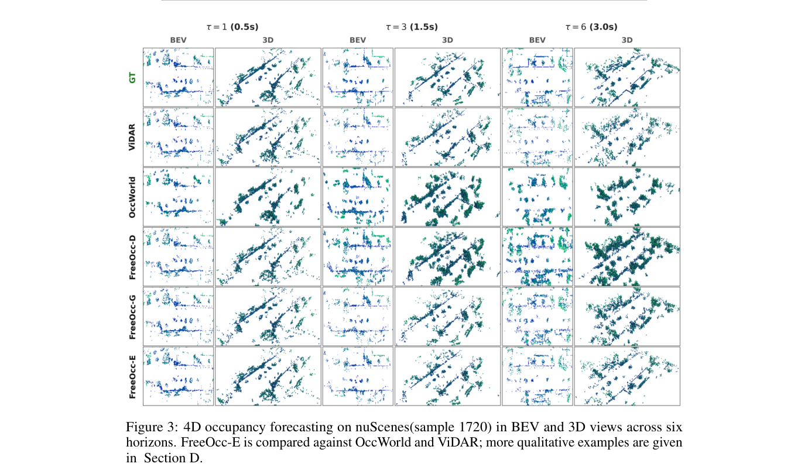
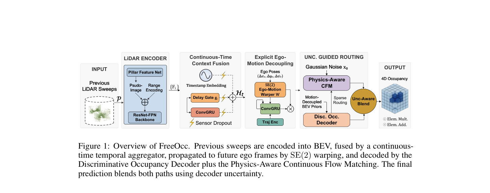

<div align="center">

# FreeOcc

### Decoupling Ego-Motion for Efficient 4D Occupancy Forecasting via Continuous Flow Matching

[](https://neurips.cc/)
[](https://arxiv.org/abs/2611.08128)

**Zeping Zhang**¹ · **Zhuoya Zhao**¹ · **Samy Metari**² · **Robert Laganière**¹†

¹ University of Ottawa &emsp; ² National Research Council Canada (NRC)  
† Corresponding author

[Paper](https://arxiv.org/abs/2611.08128) · [PDF](https://arxiv.org/pdf/2611.08128)

</div>

---

<p align="center">
  
</p>
<p align="center"><em>Figure 3. 4D occupancy forecasting on nuScenes (sample 1720) in BEV and 3D views.</em></p>

---

## TL;DR

FreeOcc is a lightweight continuous-time 4D occupancy world model. It **explicitly decouples ego-motion** with $\mathrm{SE}(2)$ warping, then forecasts residual scene dynamics with physics-constrained continuous flow matching and uncertainty-aware routing.

| | |
|---|---|
| **Venue** | NeurIPS 2026 |
| **Params** | **28.3M** |
| **Speed** | **27 FPS** (FreeOcc-E) |
| **nuScenes** | **0.47 m** NFCD · **32.1%** mIoU |
| **Robustness** | Zero-shot SemanticKITTI; **92.8%** ideal mIoU under packet loss / jitter |

---

## Highlights

1. **Explicit $\mathrm{SE}(2)$ ego-motion decoupling** — factor out known planner motion; learn residual dynamics only.
2. **Attention-free temporal fusion** — lightweight ConvGRU with timestamp / delay gating.
3. **Physics-constrained continuous flow matching** — ODE generation on residual agent kinematics.
4. **Uncertainty-aware dual-path decoding** — fast decoder for confident voxels; CFM ODE for ambiguous regions.

---

## Architecture

<p align="center">
  
</p>

---

## Code

Code and checkpoints will be released upon completion of federal procedures.

---

## Acknowledgements

This work was partially funded by the National Research Council Canada (NRC) and the Natural Sciences and Engineering Research Council (NSERC) of Canada.

---

## Citation

```bibtex
@article{zhang2026freeocc,
  title={FreeOcc: Decoupling Ego-Motion for Efficient 4D Occupancy Forecasting via Continuous Flow Matching},
  author={Zhang, Zeping and Zhao, Zhuoya and Metari, Samy and Lagani{\`e}re, Robert},
  journal={arXiv preprint arXiv:2611.08128},
  year={2026}
}
```
